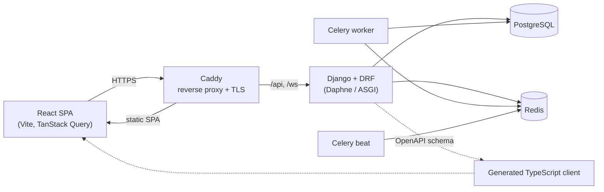

# StudioOS

> Management platform for dance schools — enrollments, classes, private coachings, billing, events, inventory and a member marketplace in one place.

<!-- TODO: hero screenshot or short GIF of the dashboard -->


StudioOS is an academic project developed at **IPCA — Instituto Politécnico do Cávado e do Ave** <!-- TODO: course name, curricular unit, academic year -->, built around the real day-to-day of a dance school with around 400 students and 8 studios.

## Repository layout

| Folder | Contents |
|---|---|
| [`web/`](web/) | React single-page application ([web/client/README.md](web/client/README.md)) |
| [`api/`](api/) | Django REST API, background workers, infrastructure ([api/README.md](api/README.md)) |
| [`api/docs/`](api/docs/) | Architecture, domain models, feature specs, test reports |

The two parts were developed in separate repositories and merged here with their full commit history.

---

## Table of contents

- [The problem](#the-problem)
- [Features](#features)
- [Screenshots](#screenshots)
- [Architecture](#architecture)
- [Tech stack](#tech-stack)
- [Getting started](#getting-started)
- [Testing and quality](#testing-and-quality)
- [Project management](#project-management)
- [Development process and AI usage](#development-process-and-ai-usage)
- [Team](#team)
- [License](#license)

---

## The problem

<!-- TODO: 1–2 paragraphs. How the school worked before (spreadsheets, WhatsApp, paper forms?), what hurt, who the users are. -->

## Features

<!-- TODO: trim / reorder; one line each, user-facing language -->

- **Enrollments** — public enrollment form with consents and payment proof, enrollment periods, review workflow
- **Classes and studios** — modalities, studios, class scheduling
- **Coachings** — private lessons requested by students or scheduled by coordination, with a status machine, teacher availability and late-cancellation fines
- **Billing** — billing entries, split payments, fines
- **Events** — event pages, ticket reservations
- **Inventory** — school costumes and equipment with variants, sizes and bookings
- **Marketplace** — members buy, sell and rent dancewear, with offers and conversations
- **Messaging** — real-time conversations over WebSockets
- **Roles and permissions** — direction, coordination, teachers, students and guardians (guardian delegation for minors)
- **Internationalisation** — Portuguese and English

## Screenshots

<!-- TODO: add images under docs/screenshots/ -->

| | |
|---|---|
|  |  |
|  |  |

## Architecture



Key design decisions:

- **API-first.** The backend publishes an OpenAPI schema (drf-spectacular); the frontend's API client is generated from it, so request and response types stay in sync.
- **Layered backend.** Views only handle HTTP; business rules live in services; an architecture test enforces the layering. See [`api/docs/architecture.md`](api/docs/architecture.md).
- **Soft delete and audit fields** on every domain model.
- **httpOnly cookie auth** with short-lived JWT access tokens and rotating refresh tokens.

<!-- TODO: link to any diagrams (ERD, use cases, sequence diagrams) from the report -->

## Tech stack

| Layer | Technology |
|---|---|
| Frontend | React 19, TypeScript, Vite, Tailwind CSS 4, shadcn/ui, TanStack Query/Table, React Hook Form + Zod, TipTap, i18next |
| Backend | Python 3.13, Django 5.2, Django REST Framework, SimpleJWT, drf-spectacular, Channels |
| Async | Celery, Celery Beat, Redis |
| Data | PostgreSQL |
| Infrastructure | Docker Compose, Caddy, Azure DevOps Pipelines |

## Getting started

### Prerequisites

- Docker Desktop
- Node.js 20+

### 1. Start the API

```bash
git clone <repository-url> studioos
cd studioos/api
cp server/.env.example server/.env   # set SECRET_KEY, DB passwords, and DEBUG=True for local dev
docker compose up --build
```

In a second terminal, load demo data (users for every role, classes, coachings, events, inventory):

```bash
docker compose exec api uv run python manage.py seed_demo_data
```

### 2. Start the web client

```bash
cd studioos/web/client
cp .env.example .env
npm install
npm run dev
```

Open http://localhost:5173.

<!-- TODO: list demo accounts created by seed_demo_data (role → email) -->

## Testing and quality

- **Backend:** pytest suite covering services, API contract, integration flows, invariants and architecture rules — see [`api/docs/testing.md`](api/docs/testing.md)
- **Static checks:** Ruff + Black (backend), TypeScript strict mode + Prettier (frontend), enforced in CI; ESLint findings posted as pull request comments
- **Manual / end-to-end:** test plans and reports in [`api/docs/testing/`](api/docs/testing/) and [`api/docs/reports/`](api/docs/reports/)

<!-- TODO: coverage number, how to run tests locally -->

## Project management

<!-- TODO: describe the process — sprints, ceremonies, how work was split. Add exported artefacts under docs/planning/ -->

- Work was planned in **Azure DevOps Boards** with sprints and PBIs
- Feature specifications written before implementation: [`api/docs/feature/`](api/docs/feature/)
- Domain modelling per bounded context: [`api/docs/domain/`](api/docs/domain/)
- Backlog status and open design questions: [`api/docs/backlog-status.md`](api/docs/backlog-status.md), [`api/docs/open-questions.md`](api/docs/open-questions.md)

## Development process and AI usage

<!-- TODO: write honestly, and check it matches IPCA's academic-integrity rules -->

AI coding assistants (Claude Code, GitHub Copilot, Cursor) were used during development, mainly for:

- <!-- e.g. scaffolding repetitive CRUD code and tests -->
- <!-- e.g. UI implementation from our own design guidelines -->
- <!-- e.g. automated end-to-end test runs (see api/docs/reports/) -->

Architecture, domain modelling, requirements and final review of all code were done by the team.

## Team

<!-- TODO: confirm names, roles and links -->

| Name | Role |
|---|---|
| João Borges | |
| Daniel Batista | |
| Juliana Gonçalves | |
| <!-- TODO: GitHub user RicFer30 --> | |

Supervised by <!-- TODO: professor name -->.

## License

<!-- TODO: choose a license (MIT is common for academic work) and add a LICENSE file -->
